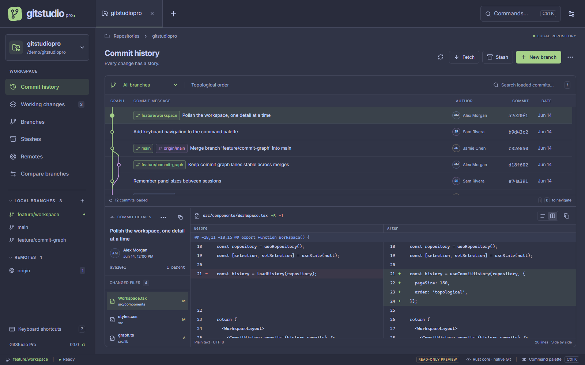
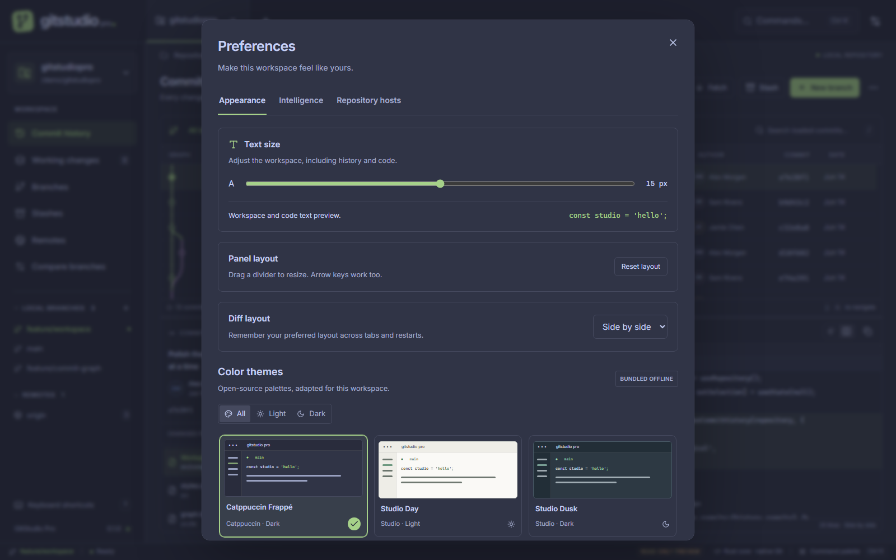
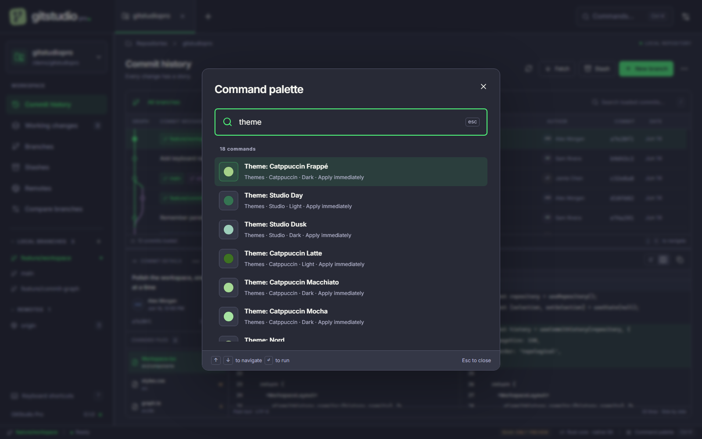
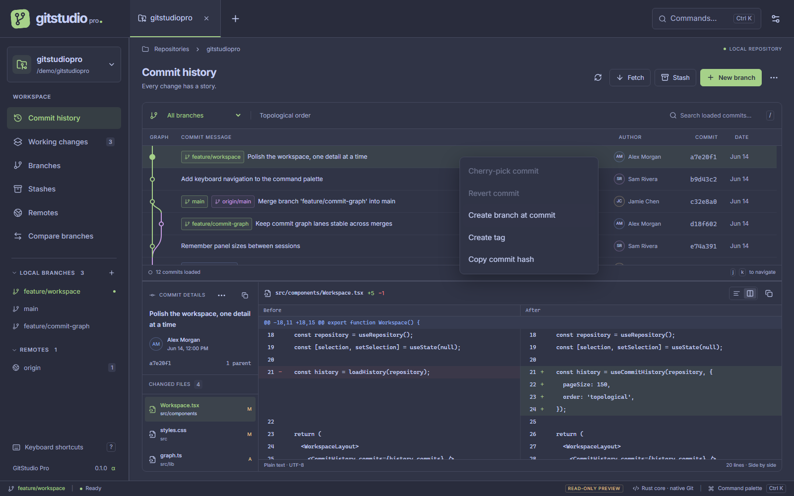
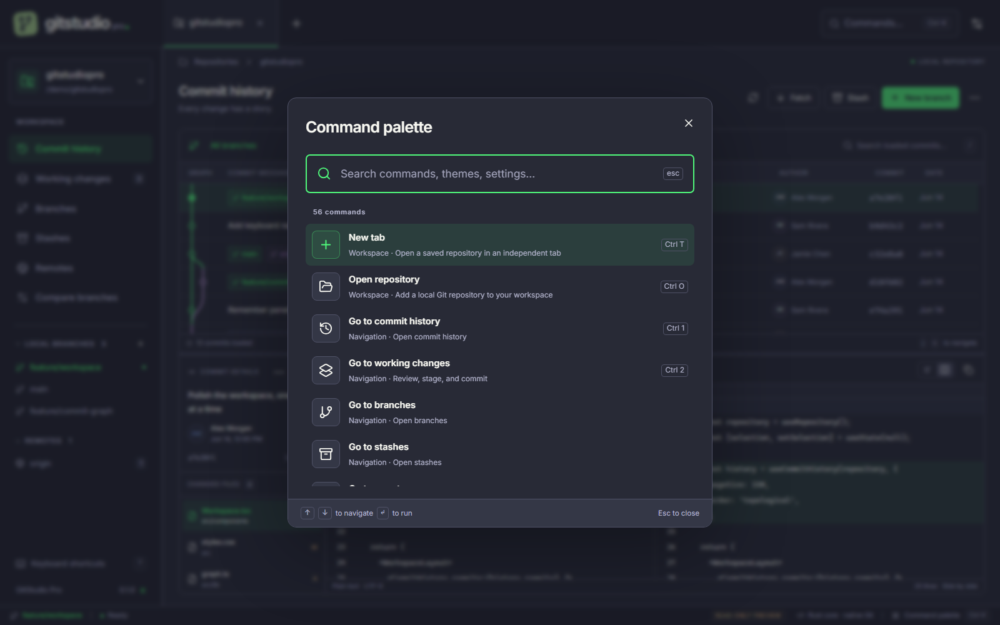

<p align="center"></p>

<h1 align="center">GitStudio Pro</h1>
<p align="center"><strong>A considered workspace for Git.</strong><br>Rust at the core. A clear view of your code. Windows and macOS.</p>

<p align="center">
  <a href="https://github.com/realsaraf/gitstudiopro/actions/workflows/ci.yml"></a>
  <a href="LICENSE"></a>
  
</p>



GitStudio Pro is an open-source desktop Git client built from scratch with
**Rust, Tauri 2, React, and TypeScript**. Inspired by the practical workflows of
Git Extensions, it puts repository history, working changes, and file diffs in
one focused workspace.

**0.1 is an early alpha.** Core local workflows are implemented; full Git Extensions
parity, direct pull-request integrations, and AI assistance are not. See the
[roadmap and known limits](docs/roadmap.md) and [validation evidence](docs/validation.md).
The [source-based Git Extensions parity matrix](docs/parity/README.md) records
what is implemented, native-tested, partial, and missing against a pinned upstream revision.

## Inside the workspace

- **Follow the history.** A real topological commit graph, local/remote refs,
  150-commit pages, branch filtering, loaded-commit search, and virtualized rows.
- **Inspect every change.** File lists, commit metadata, unified or side-by-side
  diffs, line numbers, and keyboard selection.
- **Make the next commit.** Stage and unstage individual files, write a commit,
  create/switch/rename branches, track remote branches, and save/apply/pop/drop stashes.
- **Work with history.** Commit context menus expose cherry-pick, revert,
  branch-at-commit, and tags. Branch menus expose merge/rebase. Conflicted
  operations show Continue/Abort/Skip controls after external-editor resolution.
- **Keep repositories close.** Independent tabs, recent folders, native directory
  selection, and a searchable command palette.
- **Sync deliberately.** Fetch configured remotes, fast-forward pull, and push
  HEAD to the current branch's configured upstream. No force-push control.
- **Make it comfortable.** Resizable panels, 12–18px text, reduced motion, and
  15 offline palettes with upstream credits and license notices.



## Everything within reach

Press **Ctrl+K** on Windows or **Cmd+K** on macOS and start typing. Select any
of the 15 themes directly, set text size, toggle reduced motion, reset panel
layout, or change the persistent diff layout. Current settings are marked in the
results. Search accepts words in any order, aliases such as `font` and `zoom`,
and accent-free theme names such as `frappe`.

The palette also switches open tabs, opens recent repositories, shows shortcuts,
and opens the existing branch/stash/pull/push dialogs. Unavailable actions explain
why. AI and direct host integrations remain explicitly labeled as planned.



See the [command palette guide](docs/command-palette.md) for shortcuts and examples.

Right-click a commit (or press **Shift+F10** in history) to open its actions.
Repository, branch, and stash menus expose the corresponding operations.
See the [native workflow test guide](docs/native-workflows.md) for reproducible
UI-driven tests and the limits of that evidence.



## Run locally

Install [Node.js 22](https://nodejs.org/), [stable Rust](https://rustup.rs/), and
[Git 2.30+](https://git-scm.com/downloads). Complete the
[Tauri platform prerequisites](https://v2.tauri.app/start/prerequisites/):

| Platform      | Native prerequisites                                          |
| ------------- | ------------------------------------------------------------- |
| Windows 10/11 | Visual Studio C++ Build Tools + Windows SDK; WebView2 runtime |
| macOS 11+     | Xcode Command Line Tools (`xcode-select --install`)           |

```sh
git clone https://github.com/realsaraf/gitstudiopro.git
cd gitstudiopro
npm ci
npm run desktop
```

Use **Open repository** or **Ctrl/Cmd O** to open an existing local clone. Git uses
your existing identity, hooks, SSH agent, and credential helper. Configure these
with Git before committing or syncing.

For frontend-only development:

```sh
npm run dev
# Open http://127.0.0.1:1420
# Add ?demo=true for the read-only visual preview.
```

The browser preview uses fictional fixture data and refuses Git writes. The
desktop build always uses the real Rust backend; it never falls back to fixtures.
README images show this labeled preview, not private repositories or live release evidence.

## Build and test

```sh
npm run build
npm test
npx playwright install chromium
npm run test:e2e
npm run test:native:workflows # Windows; requires a built native app
cargo test --locked --manifest-path src-tauri/Cargo.toml
cargo clippy --locked --manifest-path src-tauri/Cargo.toml --all-targets -- -D warnings
npm run tauri -- build
```

Packages are written under `src-tauri/target/release/bundle/`. Windows builds
produce installers; macOS builds produce an app bundle and DMG. Build on the
target platform. The [CI workflow](.github/workflows/ci.yml) checks Windows and
macOS and uploads unsigned artifacts; code signing and notarization are future work.

On Windows, `npm run test:native` exercises actual Tauri IPC against a disposable
repository after `cargo build --manifest-path src-tauri/Cargo.toml` and with the
dev server running. Set `GITSTUDIO_BINARY` to a release executable to test that build.

## Designed to do less unnecessary work

The operating system supplies the WebView; no Electron or Node runtime ships
with the app. Rust runs Git off the UI thread. History is paged and virtualized,
diffs load on selection, output is bounded, and unrelated repositories do not
share an operation lock. There is no telemetry or background cloud polling.

These are implementation choices, not unmeasured speed claims. Read the
[architecture](docs/architecture.md) for boundaries, limits, and tradeoffs.



## Keyboard essentials

| Action                    | Windows / macOS                 |
| ------------------------- | ------------------------------- |
| Command palette           | Ctrl K / Cmd K                  |
| Open repository           | Ctrl O / Cmd O                  |
| New / close tab           | Ctrl T / Cmd T · Ctrl W / Cmd W |
| History / working changes | Ctrl 1 / Cmd 1 · Ctrl 2 / Cmd 2 |
| Preferences               | Ctrl , / Cmd ,                  |
| Refresh                   | Ctrl R / Cmd R                  |
| Search loaded commits     | `/`                             |
| Navigate focused history  | `j` / `k` or arrow keys         |
| Show shortcuts            | `?`                             |

## Open source, with credit

The community themes are open-source adaptations: **Catppuccin, Nord, Dracula,
Solarized, Gruvbox, Tokyo Night, Rosé Pine, and One Dark**. They retain their
upstream licenses and attribution. Studio Day and Studio Dusk are project palettes.
Inter and Lucide are bundled with their notices too.

See [Third-party notices](THIRD_PARTY_NOTICES.md), [complete theme licenses](licenses/),
and Preferences → Appearance → Open-source credits & licenses.

Want to help? Start with [CONTRIBUTING.md](CONTRIBUTING.md), the
[roadmap](docs/roadmap.md), and [open issues](https://github.com/realsaraf/gitstudiopro/issues).
Please follow the [community conduct](CODE_OF_CONDUCT.md) and report vulnerabilities
according to [SECURITY.md](SECURITY.md).

Project code: [MIT](LICENSE). Independent from Git Extensions and theme authors.
